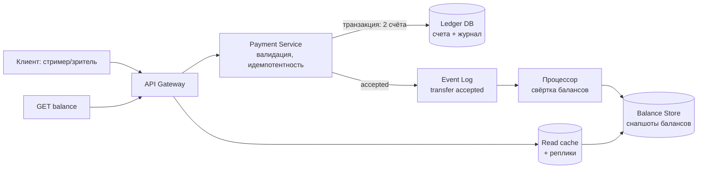

# Решение 1 — банкинг для сервиса стриминга (донаты)

Фиксированные вводные: 10 000 переводов/с, 50 000 чтений баланса/с, 800 млн
счетов и +800 млн/год, одна валюта, идемпотентность повторов, CP по CAP,
SLI доступности 99,95%, принятый платёж обязан исполниться.

## Общая архитектура

Три слоя: приём платежей (validate → принять → подтвердить), журнал операций
(источник истины, append-only), балансы (материализованное состояние).
Чтение балансов отделено от проводок: 50k RPS чтений — это кэш и реплики,
10k RPS проводок — это транзакционная запись.



## Пошаговый алгоритм перевода

1. `POST /transfer/local` с `Idempotency-Key` приходит в Payment Service.
   Ключ проверяется по таблице операций: повтор возвращает сохранённый
   результат и ничего не списывает.
2. Валидация: существование счетов, amount > 0, одна валюта (дано).
3. Транзакция в Ledger DB: блокировка двух строк счетов **в детерминированном
   порядке** (по возрастанию id счёта) — иначе deadlock при встречных
   переводах; проверка баланса списания `balance >= amount`; проводка
   списание/зачисление + строка в журнал операций; COMMIT.
4. Ответ клиенту 200/201 — платёж исполнен. Событие в Event Log нужно
   уведомлениям и балансовым свёрткам, но ответ от него не зависит.
5. `GET /balance` читает материализованный баланс (реплика/кэш), а не
   транзакционную базу проводок.

CP: при split-brain побеждает кворумная группа, меньшая часть останавливает
запись — недоступность вместо расщепления. SLI 99,95% при CP достигается не
отказом от консистентности, а топологией: минимум 3 зоны доступности,
синхронная репликация кворумом (2 из 3), автоматический failover лидера.

## Модель данных

```sql
-- счета: шард по hash(account_id)
CREATE TABLE accounts (
    account_id BIGINT PRIMARY KEY,
    user_id    BIGINT NOT NULL,
    balance    BIGINT NOT NULL DEFAULT 0,      -- копейки, не REAL
    version    BIGINT NOT NULL,                -- оптимистичная блокировка
    created_at TIMESTAMPTZ NOT NULL
);

-- журнал: append-only, источник истины, партиции по времени
CREATE TABLE transfers (
    transfer_id     UUID PRIMARY KEY,
    idempotency_key TEXT NOT NULL UNIQUE,      -- защита повторов
    from_account    BIGINT NOT NULL,
    to_account      BIGINT NOT NULL,
    amount          BIGINT NOT NULL,
    status          TEXT NOT NULL,             -- accepted/executed/failed
    created_at      TIMESTAMPTZ NOT NULL
);

-- hot-wallet протокол (см. горячие счета): незачисленные события
CREATE TABLE pending_credits (
    credit_id  BIGSERIAL PRIMARY KEY,          -- шард hash(to_account)
    account_id BIGINT NOT NULL,
    amount     BIGINT NOT NULL,
    applied_at TIMESTAMPTZ
);
```

Деньги — BIGINT в копейках или NUMERIC; никакого float. Идемпотентность —
UNIQUE на ключе операции: повтор ловится на вставке, а не на честном слове.

## Один сервис или несколько

Разделение по путям нагрузки: Payment Service (проводки, 10k RPS, строгая
консистентность) отдельно от Balance Read API (50k RPS, eventual по
свёртке). Общая база — нет: у слоёв разные требования к консистентности и
масштабированию, их связывает Event Log. Создание счёта — дешёвая операция
того же Payment Service (+800 млн/год = ~25 вставок/с — не нагрузка).

## Горячие счета

Тысячи донатов в секунду в одну строку баланса — одна блокировка на строку:
проводка «зачисление» — узкое место. Решение: списания всегда синхронны
(баланс отправителя проверить обязан), зачисления — через буфер:

- зачисление пишется в `pending_credits` (свой шард по получателю,
  append-only, конкуренция нулевая) и событие в Event Log;
- процессор переносит накопленное в баланс батчами (одна транзакция на N
  донатов = одна блокировка строки);
- «деньги приняты — обязаны дойти» выполнено: pending — уже часть
  committed-состояния, а не буфер в памяти; возврат по отказу невозможен,
  только перенос в баланс.

Чтение баланса горячего счёта: баланс-снапшот + сумма непримененных
pending (или просто eventual consistency с лагом в секунды — для донатов
достаточно).

## Масштабирование хранилища

- PostgreSQL-путь: шардирование приложением/Citus/Vitess, шарды по
  account_id; межшардовые переводы — 2PC или перевод-в-два-шага
  (резервирование на отправителе → зачисление у получателя → фиксация),
  оба счёта в одном шарде не гарантированы. Реплики + pg_cat для чтения.
  Плюс: зрелость, экосистема. Минус: 2PC на 10k RPS — операционно сложно.
- Распределённые СУБД (CockroachDB, YugabyteDB, FoundationDB-подход):
  serializable-транзакции между шардами из коробки, raft-кворумы по
  диапазонам ключей = CP и failover бесплатно. Плата — меньшая пиковая
  латентность записи и стоимость кластера. Для «10k TPS, CP, сотни
  миллионов ключей» — честный дефолт, если команда не несёт Vitess-опыта.

## Шардирование: хеш против диапазонного

- **Hash(account_id)** для `accounts` и `pending_credits`: равномерная
  нагрузка, нет горячих точек, добавление узлов через consistent hashing /
  удвоение шардов. Плата: диапазонные запросы (все счета пользователя)
  требуют scatter-gather по всем шардам — а их мало и они точечные.
- **Range по времени (created_at)** для `transfers`: журналappend-only,
  активная зона — последний диапазон; старые партиции холодные, легко
  архивируются, отчёты по датам читают смежные диапазоны. Плата: insert
  hotspot на последнем диапазоне — лечится партиционированием последней
  партиции на суб-диапазоны по transfer_id.
- Правило: измерения по равенству/точкам → hash; упорядоченные/временные
  данные и range-сканы → range. Смешанный случай — двухуровневое
  шардирование: диапазон по времени, внутри хеш по ключу сущности.

## Риски и что мониторить

- deadlock переводов (фиксируется порядком блокировок) — alert на
  рестарты транзакций;
- лаг свёртки pending → баланс (для стримера «донат пришёл» — продукт!);
- consumer lag Event Log, глубина очередей, quorum health кластера;
- идемпотентность: тест повторов 200/с на одном ключе.
