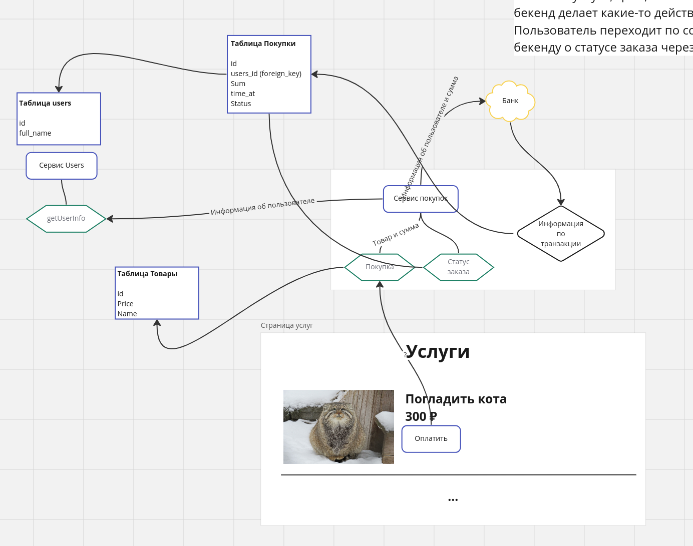

# Решение 1 — кнопка «Оплатить»

Диаграмма с собеседования:

## Компоненты

Таблицы БД:

- `users` (id, full_name) — справочник пользователей;
- «Покупки» (Id, users_id — внешний ключ на users, Sum, time_at, Status) — журнал заказов;
- «Товары» (id, Price, Name) — каталог услуг.

Сервисы и эндпоинты:

- «Сервис Users» с методом `getUserInfo` — внешняя сущность «эндпоинт, возвращающий
  пользователей»; читает таблицу users;
- «Сервис покупок» — эндпоинты «Покупка» (нажатие кнопки «Оплатить») и «Статус заказа»;
- «Банк» — внешний платёжный шлюз.

## Поток

1. Кнопка «Оплатить» на странице услуг вызывает эндпоинт «Покупка» (товар и сумма).
2. Эндпоинт сверяется с таблицей «Товары»; сервис покупок через `getUserInfo` получает
   информацию о пользователе.
3. Сервис покупок отправляет в банк информацию о пользователе и сумму.
4. Банк возвращает информацию по транзакции — она фиксируется записью в таблице «Покупки».
5. Итоговый статус заказа банк сообщает бекенду асинхронно через web hook; фронтенд
   отслеживает состояние через эндпоинт «Статус заказа».

## Замечания

- Сервис покупок читает таблицу «Товары» напрямую — в микросервисной архитектуре лучше
  обращаться через API владельца данных.
- Идемпотентность кнопки (двойной клик — двойной платёж) и поведение при потере web hook
  на схеме не показаны.
