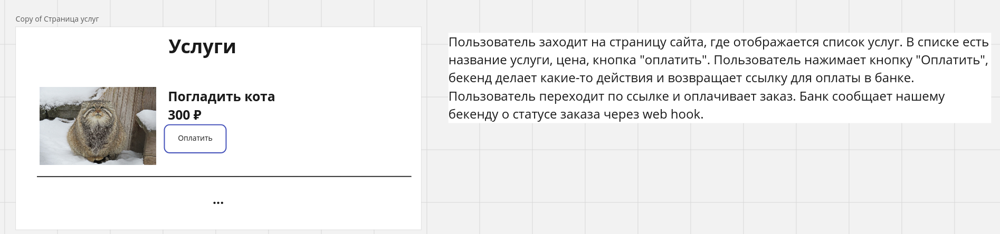

# СберАвто — заход 1, системный дизайн

- Даты: неизвестна (~2023, первый заход поиска)
- Формат: онлайн, постановка на экране (макет страницы + текст); архитектуру с таблицами БД и микросервисами рисует кандидат

## 1. Кнопка «Оплатить»

Нарисовать архитектуру приложения: что будет происходить на бэкенде при нажатии кнопки пользователем. В задаче две внешние сущности: эндпоинт, возвращающий пользователей, и банк.

Вводная с экрана (дословно):

```text
Пользователь заходит на страницу сайта, где отображается список услуг. В списке есть
название услуги, цена, кнопка "оплатить". Пользователь нажимает кнопку "Оплатить",
бекенд делает какие-то действия и возвращает ссылку для оплаты в банке. Пользователь
переходит по ссылке и оплачивает заказ. Банк сообщает нашему бекенду о статусе заказа
через web hook.
```

Экран задания (схема постановки — макет страницы услуг):


